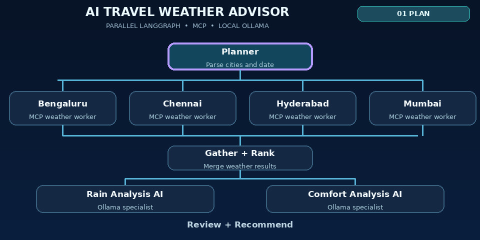
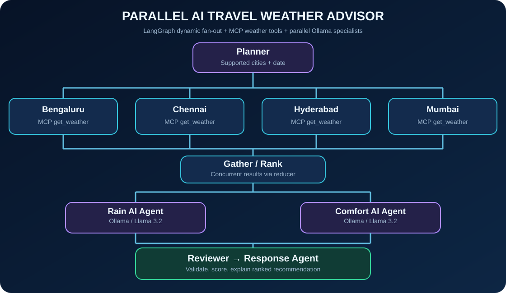

<div align="center">

# 🌦️ Parallel AI Travel Weather Advisor

### LangGraph · Ollama · MCP · Agent Skills · Open-Meteo · Streamlit

**Four city-weather workers in parallel. Two LLM analysis agents in parallel. One explainable travel recommendation.**



[](https://www.python.org/)
[](https://langchain-ai.github.io/langgraph/)
[](https://ollama.com/)
[](https://modelcontextprotocol.io/)
[](tests/)

**Local-first portfolio proof of concept · No paid LLM API key · Live forecasts require internet**

</div>

---

## 🎯 The problem

Choosing a destination for outdoor activities involves multiple weather signals. Rather than querying cities one by one, this project takes a question such as:

> **“Compare the weather in Bengaluru, Chennai, Hyderabad, and Mumbai for tomorrow. Analyze temperature, rainfall and wind, and recommend the best city for outdoor activities.”**

It retrieves forecasts in **parallel**, independently analyzes **rain** and **comfort**, checks the outputs, and ranks candidate cities using a **visible, reproducible scoring heuristic**.

## ✨ What makes it different

| Feature | What is implemented |
| --- | --- |
| **Dynamic parallelism** | LangGraph `Send` launches one independent weather worker per selected city |
| **True MCP client/server** | Each worker uses MCP stdio discovery and `get_weather` tool invocation |
| **Two concurrent LLM specialists** | Rain and Comfort nodes each call local Ollama independently |
| **Shared state & merge** | LangGraph `Annotated[..., operator.add]` reducers collect worker outputs |
| **Join & review** | Reviewer waits for both analyses and checks their availability |
| **Explainable recommendation** | Deterministic 45/35/20 rain/temperature/wind *demo* score |
| **Interactive demonstration** | Streamlit ranking table and trace of execution events |
| **Offline rehearsal** | Clearly labeled simulated mode; no real MCP or Ollama in that mode |

## 🏗️ Architecture



**Request flow:** `Streamlit → Planner → 4 × MCP Weather Workers → Gather → (Rain AI ∥ Comfort AI) → Reviewer → Response AI → Streamlit`.

**What is an “agent” here?** The four weather branches are *parallel tool workers*, not four independently reasoning LLM agents. The Rain and Comfort nodes are separately prompted AI specialists. Planning and ranking are deterministic Python operations.

## 🚀 Quick start — Windows + VS Code

### Requirements

- Python **3.12** recommended (other versions depend on library compatibility)
- [Ollama](https://ollama.com/download) running on your laptop, with the `llama3.2` model
- Internet to fetch live forecasts from [Open-Meteo](https://open-meteo.com/)
- Windows PowerShell or CMD and VS Code

```cmd
py -3.12 -m venv .venv
.venv\Scripts\python.exe -m pip install --upgrade pip
.venv\Scripts\python.exe -m pip install -r requirements.txt
ollama pull llama3.2
ollama list
```

### Run the application

```cmd
.venv\Scripts\python.exe -m streamlit run app.py
```

Open **http://localhost:8501**. Keep **Simulated offline demo unchecked** to run real MCP + Open-Meteo + Ollama.

### Run in the command line

```cmd
.venv\Scripts\python.exe cli.py
```

### Test without depending on external services

```cmd
.venv\Scripts\python.exe -m pytest -v
.venv\Scripts\python.exe test_mcp.py
.venv\Scripts\python.exe cli.py --demo
```

> **Testing clarification:** `pytest` uses simulated data and does not prove live forecasts. `test_mcp.py` uses a real local MCP subprocess with simulated weather. `--demo` uses fictional weather and simulated analyses and is **not** a live end-to-end integration test.

## 🧠 Multi-agent workflow, step by step

1. **Planner** parses the supported city names and requested day (`today` or `tomorrow`). It is deterministic, not an LLM-based planner.
2. **LangGraph `Send`** fans out one task per selected city.
3. **Weather workers** create MCP stdio sessions, discover `get_weather`, and call the separate weather server.
4. **Open-Meteo** returns daily temperature, rain probability, wind speed and precipitation via asynchronous HTTPX. Known city coordinates avoid ambiguous geocoding.
5. **Gather** combines success/failure records and ranks successfully retrieved cities; failures are disclosed.
6. **Rain AI and Comfort AI** run in parallel with different instructions against local Ollama.
7. **Reviewer** requires a usable ranking and both specialist outputs; otherwise it routes to an error response.
8. **Response AI** explains the precomputed winner and explicitly labels the score as a subjective demo heuristic.

## 🔌 MCP integration

- **MCP server:** `travel_agent/mcp_server.py` (`FastMCP` using stdio)
- **MCP client:** `travel_agent/mcp_client.py` (`stdio_client`, `ClientSession`, `list_tools()`, `call_tool()`)
- **Tool actually invoked:** `get_weather(city, date)`
- **Resource and prompt also exposed:** `weather://about`, `travel_brief` — not consumed by the active graph
- **External weather API:** `https://api.open-meteo.com/v1/forecast`

MCP is for tool connectivity. **Ollama is the LLM runtime, not the MCP server.** The model does not freely select the weather tool; Python selects it from the validated plan.

## 📊 Recommendation scoring

A simple deterministic **demo heuristic**, not an official outdoor-safety or meteorological index:

| Signal | Weight | Interpretation |
| --- | ---: | --- |
| Rain probability | **45%** | Lower is preferred |
| Temperature | **35%** | Closer to an illustrative 25°C is preferred |
| Maximum wind speed | **20%** | Lower is preferred |

Implementation: [`travel_agent/decision.py`](travel_agent/decision.py) (`score_weather` and `rank_results`). The score is for comparing the four supported cities, **not for severe-weather safety decisions**. Check official weather alerts for hazardous conditions.

## 🗂️ Code map

| Where | Why it matters |
| --- | --- |
| [`travel_agent/graph.py`](travel_agent/graph.py) | Shared state, `Send` fanout, joining branches, specialist agents |
| [`travel_agent/mcp_client.py`](travel_agent/mcp_client.py) | Real MCP tool discovery and invocation |
| [`travel_agent/mcp_server.py`](travel_agent/mcp_server.py) | MCP weather tool, resource and prompt |
| [`travel_agent/weather.py`](travel_agent/weather.py) | Open-Meteo forecast and offline simulation |
| [`travel_agent/decision.py`](travel_agent/decision.py) | Input planning, transparent scoring and ranking |
| [`travel_agent/llm.py`](travel_agent/llm.py) | Async local Ollama chat calls |
| [`travel_agent/skills.py`](travel_agent/skills.py) | Loads the weather-advisor skill instructions |
| [`skills/outdoor-travel-advisor/SKILL.md`](skills/outdoor-travel-advisor/SKILL.md) | Reusable domain instructions |
| [`app.py`](app.py) | Streamlit user experience and visible execution trace |
| [`tests/`](tests/) | Offline graph and decision tests |

## 🧪 Quality and limits

The repository includes **offline pytest tests** and a GitHub Actions test workflow. These should be validated on your GitHub account after publication. An end-to-end **live** run depends on local Ollama, internet access to Open-Meteo, and valid MCP subprocess execution.

**Not implemented:** persistent memory/checkpointing, arbitrary global cities, autonomous tool selection by the model, retry/backoff, model evaluation metrics, official weather alerts, production monitoring, cloud deployment, and performance benchmarks. Parallel scheduling may not make inference faster on a constrained local model.

## 🎬 Interview walkthrough & contribution

- [Architecture and interview speaking notes](docs/INTERVIEW_WALKTHROUGH.md)
- [GitHub upload instructions (no terminal Git commands)](docs/GITHUB_UPLOAD_GUIDE.md)
- [Source of the animated illustration](assets/workflow.gif)

**Project status:** Local technical demonstration / portfolio proof of concept. Real-world results vary by date; the animation is an *architecture illustration*, not a live UI recording.

---

<div align="center">

**Parallel retrieval · Explainable scoring · Local AI · Standardized tools**

</div>
